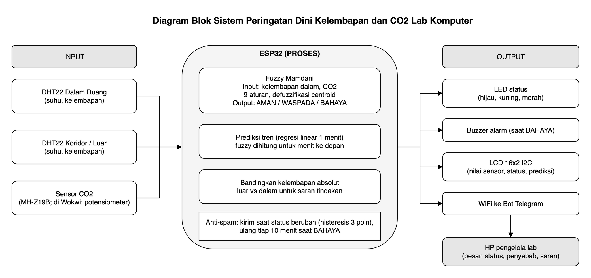

# labguard-fuzzy-iot

Sistem Peringatan Dini Kelembapan dan CO2 Lab Komputer

Sistem membaca kelembapan dan CO2 di lab komputer, menilai kondisi ruangan dengan fuzzy logic (Aman, Waspada, Bahaya), memprediksi kapan ruangan masuk zona bahaya, lalu mengirim peringatan lewat bot Telegram. Sensor di luar ruangan dipakai untuk membandingkan kelembapan, supaya saran yang dikirim tepat (buka pintu atau justru tahan pintu tertutup).



## Isi folder

| File | Dibuka di | Fungsi |
|---|---|---|
| `wokwi/sketch.ino` | Wokwi | Kode ESP32 |
| `wokwi/diagram.json` | Wokwi | Rangkaian komponen |
| `wokwi/libraries.txt` | Wokwi | Daftar library |
| `wokwi/compile.sh`, `wokwi/wokwi.toml` | Antigravity / VS Code | Compile dan jalankan simulasi Wokwi dari aplikasi di komputer |
| `drawio/rancangan_sistem.drawio` | draw.io | Diagram blok dan flowchart (2 halaman) |
| `drawio/diagram_blok.png` | | Gambar diagram blok (ekspor dari file draw.io) |
| `python/fuzzy_kelas.py` | Terminal / VS Code | Uji fuzzy, grafik untuk laporan |
| `python/output/` | | Grafik fungsi keanggotaan, permukaan fuzzy, tabel uji |

## Yang perlu di-download

Wajib: tidak ada. Wokwi dan draw.io jalan di browser.

Opsional:
1. Telegram di HP (kalau mau pesan bot benar-benar masuk).
2. draw.io Desktop untuk Mac (versi offline, gratis), atau pakai app.diagrams.net di browser.
3. Python 3 (python.org). Hanya perlu kalau mau membuat ulang grafik fuzzy. Grafiknya sudah ada di `python/output/`. Library dipasang di `.venv` khusus proyek ini (folder `python/.venv`, tidak ikut ke GitHub), supaya tidak bentrok dengan proyek lain. Jalankan dari folder repo:

   ```bash
   python3 -m venv python/.venv
   python/.venv/bin/pip install scikit-fuzzy numpy scipy networkx matplotlib
   python/.venv/bin/python python/fuzzy_kelas.py   # tabel uji + grafik ke python/output/
   python/.venv/bin/python tools/cek_fuzzy.py      # cek fuzzy ESP32 sama dengan Python (butuh g++)
   ```

   Dua baris pertama cukup sekali saja. `g++` di Mac didapat dari `xcode-select --install`.
4. Arduino IDE 2, hanya kalau nanti pakai hardware asli.

## Langkah 1: Jalankan demo di Wokwi

1. Buka wokwi.com, login (gratis), pilih New Project lalu ESP32.
2. Tab `sketch.ino`: hapus isinya, tempel isi `wokwi/sketch.ino`.
3. Tab `diagram.json`: hapus isinya, tempel isi `wokwi/diagram.json`.
4. Buka Library Manager (ikon buku), tambahkan `DHT sensor library for ESPx` dan `LiquidCrystal I2C`.
5. Klik tombol Play hijau.

Cara demo:
- Klik DHT22 kiri (dalam ruang) untuk mengatur kelembapan, misalnya naikkan ke 80%.
- Geser potensiometer untuk mengubah CO2 (kiri 400 ppm, kanan 3000 ppm).
- DHT22 kanan adalah sensor luar. Ubah kelembapannya untuk melihat saran di pesan bot berubah. Kalau sensor luar gagal dibaca, sistem tetap jalan: LCD menulis "Luar: gagal baca" dan saran ditulis tanpa membandingkan udara luar.
- Untuk memicu prediksi, naikkan kelembapan pelan-pelan (misalnya 1% tiap beberapa detik) dari 60% ke 70%. LCD baris bawah akan menampilkan "Bahaya ~X mnt".
- Isi pesan bot selalu muncul di Serial Monitor walau token belum diisi.

## Pilihan lain: jalankan Wokwi di Antigravity atau VS Code

Simulasinya sama dengan wokwi.com, tetapi kode di-compile di komputer sendiri, jadi tidak perlu antre compile seperti di wokwi.com. Simulator Wokwi versi gratis tetap butuh internet. Mode tanpa internet sama sekali hanya untuk lisensi berbayar.

Persiapan (sekali saja, contoh untuk Mac dengan Homebrew):

```bash
brew install arduino-cli
arduino-cli core install esp32:esp32 --additional-urls https://espressif.github.io/arduino-esp32/package_esp32_index.json
arduino-cli lib install "DHT sensor library for ESPx" "LiquidCrystal I2C"
```

Paket ESP32 berukuran sekitar 300 MB. Kalau unduhan terputus, jalankan ulang perintah kedua.

Lalu di Antigravity atau VS Code:

1. Pasang extension Wokwi Simulator dari menu Extensions.
2. Pilih File, Open Folder, lalu buka folder `wokwi` (bukan folder repo), supaya Wokwi langsung menemukan `wokwi.toml`.
3. Tekan F1, pilih `Wokwi: Request a New License`, klik Open. Di browser klik GET YOUR LICENSE, login ke akun Wokwi, lalu konfirmasi di browser dan di aplikasi. Langkah ini cukup sekali.
4. Buka Terminal, New Terminal, lalu jalankan `./compile.sh`. Ulangi setiap kali `sketch.ino` diubah.
5. Tekan F1, pilih `Wokwi: Start Simulator`. Rangkaian muncul di panel samping dan Serial Monitor di panel bawah. Cara demonya sama dengan di atas.

`compile.sh` menyalin `sketch.ino` ke `build/sketch/` sebelum di-compile, karena arduino-cli mewajibkan nama file `.ino` sama dengan nama foldernya. Hasil compile ada di `wokwi/build/` dan tidak ikut ke GitHub.

## Langkah 2: Sambungkan bot Telegram

1. Di Telegram, chat @BotFather, kirim `/newbot`, ikuti langkahnya, salin token.
2. Chat bot kamu sekali (kirim "halo"), supaya bot boleh mengirim pesan ke kamu.
3. Chat @userinfobot untuk melihat Chat ID kamu.
4. Di `sketch.ino`, isi `BOT_TOKEN` dan `CHAT_ID`, lalu jalankan ulang.

Penting: jangan simpan proyek Wokwi yang berisi token di akun publik, dan jangan unggah token ke GitHub. Siapa pun yang punya token bisa mengendalikan bot kamu. Kalau terlanjur bocor, minta token baru di @BotFather dengan `/revoke`.

## Langkah 3: Buka diagram

Buka `drawio/rancangan_sistem.drawio` di draw.io. Ada 2 halaman di bagian bawah: Diagram Blok dan Flowchart. Untuk laporan, ekspor lewat File, Export as, PNG.

## Logika fuzzy

Input kelembapan (%): normal (0, 0, 50, 60), tinggi (50, 65, 80), sangat tinggi (70, 80, 100, 100).
Input CO2 (ppm): baik (400, 400, 700, 900), sedang (700, 1000, 1300), buruk (1000, 1400, 3000, 3000).
Output status (0 sampai 100): aman (0, 0, 25, 45), waspada (30, 50, 70), bahaya (55, 75, 100, 100).
Status akhir: di bawah 35 Aman, 35 sampai 64 Waspada, 65 ke atas Bahaya.

| Kelembapan \ CO2 | Baik | Sedang | Buruk |
|---|---|---|---|
| Normal | Aman | Aman | Waspada |
| Tinggi | Waspada | Waspada | Bahaya |
| Sangat tinggi | Bahaya | Bahaya | Bahaya |

Metode: Mamdani, AND memakai min, agregasi memakai max, defuzzifikasi centroid.

Histeresis: status naik langsung, tetapi baru turun kalau nilai sudah 3 poin di bawah batas (di bawah 32 untuk kembali Aman, di bawah 62 untuk turun dari Bahaya). Tanpa ini, nilai sensor yang bergoyang sedikit di sekitar batas membuat status bolak-balik dan bot mengirim pesan terus. Pada uji derau acak selama 1 jam, jumlah pesan turun dari 914 menjadi 3.

Penyebab dan saran di pesan bot diambil dari aturan fuzzy yang membuat status Waspada atau Bahaya (kelembapan tinggi dan/atau CO2 buruk), jadi selalu sejalan dengan status.

Batas-batas angka di atas adalah rancangan awal. Untuk laporan, cari rujukan resmi soal kelembapan ideal ruang perangkat elektronik dan batas CO2 dalam ruang, lalu sesuaikan kalau perlu.

## Pesan yang dikirim bot

- Status berubah (Waspada, Bahaya, atau Pulih ke Aman).
- Pengingat tiap 10 menit selama masih Bahaya.
- Peringatan dini kalau tren memprediksi Bahaya dalam 30 menit ke depan (paling sering tiap 10 menit). Laju kenaikan kelembapan dan CO2 dihitung dengan regresi linear dari data 1 menit terakhir, lalu fuzzy dihitung untuk menit ke-1 sampai ke-30 dengan nilai perkiraan itu. Menit pertama yang hasilnya Bahaya dilaporkan.

## Komponen untuk hardware asli

| Komponen | Jumlah | Catatan |
|---|---|---|
| ESP32 DevKit | 1 | |
| DHT22 | 2 | Dalam ruang dan koridor. Untuk sensor luar butuh kabel panjang |
| Sensor CO2 MH-Z19B | 1 | Ubah `PAKAI_MHZ19` jadi 1, sambung TX sensor ke GPIO16 dan RX sensor ke GPIO17, VIN ke 5V |
| LCD 16x2 + modul I2C | 1 | Modul I2C yang diberi 5V biasanya menarik jalur SDA/SCL ke 5V, padahal pin ESP32 bekerja di 3,3V. Pakai pengubah level (level shifter) atau pastikan pull-up modul ke 3,3V |
| LED hijau, kuning, merah + resistor 220 ohm | 3 | |
| Buzzer pasif | 1 | Kode memakai `tone()` untuk bunyi 1000 Hz |
| Breadboard, kabel jumper, adaptor 5V | | |

Sambungan pin: DHT22 dalam GPIO15, DHT22 luar GPIO19, potensiometer/CO2 GPIO34 (Wokwi), LED hijau 25, kuning 26, merah 27, buzzer 13, LCD SDA 21 dan SCL 22, MH-Z19B GPIO16 dan 17.

Harga perlu dicek di marketplace. Di hardware asli, ganti `WIFI_SSID` dan `WIFI_PASS` dengan WiFi yang dipakai.

## Keterbatasan

- Belum diuji di hardware asli. Logika program diuji dengan simulasi di komputer (sensor tiruan) dan di Wokwi.
- Sensor DHT22 luar awalnya di GPIO4 dan di Wokwi selalu gagal dibaca (TIMEOUT). Setelah dipindah ke GPIO19, sensor terbaca normal di Wokwi. Kenapa GPIO4 gagal belum diketahui.
- MH-Z19B butuh pemanasan sekitar 3 menit setelah dinyalakan. Selama itu angkanya belum bisa dipercaya, dan program belum menandainya.
- Pesan Telegram yang gagal terkirim tidak dicoba ulang. Untuk status Bahaya, pengingat 10 menit tetap akan mengirim lagi.
- Prediksi memakai garis lurus dari data 1 menit terakhir, jadi bisa meleset kalau kenaikan tidak rata (misalnya pintu dibuka sebentar).
- Selama mengirim pesan bot (beberapa detik), program berhenti membaca sensor. Perhitungan tren sudah memakai waktu baca sebenarnya, jadi hasilnya tidak ikut melenceng.
